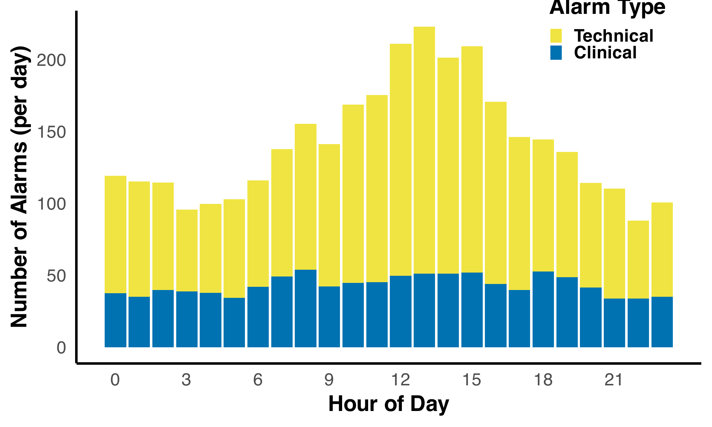
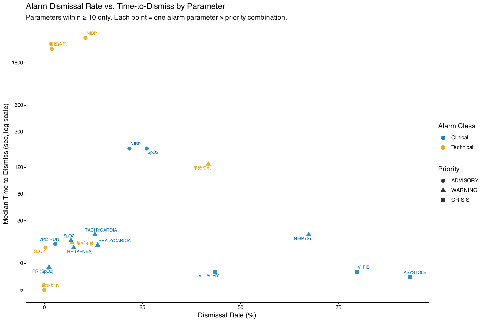
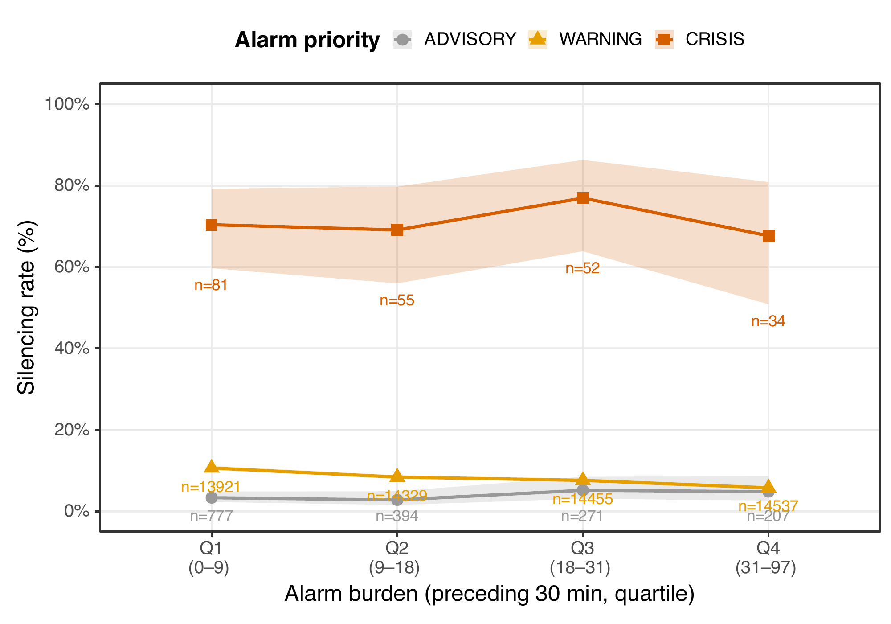

<!-- _class: title -->
<!-- _header: '' -->
<!-- _paginate: false -->

# 消化器外科病棟における生体監視モニターアラームの 優先度別消音行動とアラーム負荷の関連： セントラルモニタログ解析

**向井洋介**、北村温美、中島和江

（所属）

JDDW 2026（神戸）

---

<!-- _class: center -->

# COI 開示

演題発表に関連し、開示すべきCOI関係にある企業などはありません

---

# 背景① アラーム疲労は医療安全上の重大な課題である

**アラーム疲労**：過剰な数のアラームにさらされることで感覚が過負荷になり、アラームに鈍感になったり、アラームを見逃したりする状態（Sendelbach & Funk, AACN Adv Crit Care 2013）

- 米国の病院認証機関 The Joint Commission に報告されたアラーム関連の重大事象 98件のうち、**80件が死亡**（2009年1月〜2012年6月）（The Joint Commission, Sentinel Event Alert 2013）
- 2014年から、The Joint Commission は病院の患者安全目標（National Patient Safety Goals）にアラーム管理を加えた（The Joint Commission, R3 Report 2013）
- 消化器外科病棟では、術後患者などでモニターの使用が多い

---

# 背景② アラームの大半は臨床的に対応を要しない

- アラームの **72〜99%** は、患者に実際の異常がないのに鳴った **false alarm** だった（Sendelbach & Funk, AACN Adv Crit Care 2013）
- ICUの不整脈アラームでも、**88.8%** が **false alarm** だった（Drew et al., PLoS One 2014）
- 対応を要しないアラームに多くさらされるほど、**応答が遅れる**（Bonafide et al., J Hosp Med 2015）

 

大量のアラーム → その多くは対応を要しない → 現場の注意を消費する

---

# 背景③ これまでの対策は「不要なアラームを減らす」ことが中心だった

- 閾値の設定、遅延の設定、電極の管理
- → いずれも「アラーム負荷そのものを減らす」アプローチ
- アラーム疲労への対策を調べた研究62本は、いずれもアラームの**件数や false alarm を減らす**取り組みだった（Winters et al., Crit Care Med 2018）

 

しかし、減らす取り組みだけでは、**大量のアラームの中で現場がどう対応しているか**は見えてこない

---

# 背景④ 安全の捉え方には2つの視点がある

|  | Safety-I | Safety-II |
|---|---|---|
| 安全とは | うまくいかないことが、できるだけ少ない状態 | うまくいくことが、できるだけ多い状態 |
| 注目する対象 | 失敗・事故 | 日常の業務そのもの |
| 分析の問い | なぜ失敗したのか？ | 普段は**どのように**うまくいっているのか？ |
| 人の位置づけ | 危険源（ハザード） | 柔軟性とレジリエンスを生む資源 |

 

**複雑なシステムでは、現場の調整（適応）が安全を支えている**（Hollnagel, Safety-I and Safety-II 2014／Hollnagel et al., From Safety-I to Safety-II: A White Paper 2015）

---

# 目的

| これまでの研究（Safety-I の視点） | 本研究（Safety-II の視点） |
|---|---|
| アラームを**減らす**ことで、見逃しを防ぐ | 大量のアラームの中で、現場は**どのように調整しているか**を見る |

### Clinical Question

アラーム負荷が増えたとき、優先度の異なるアラームへの応答（消音）は、同じように変化するのか？

 

消化器外科病棟において、アラーム負荷の増大が、**優先度別の消音行動**に与える影響を検証する

---

# 方法

- **対象**：消化器外科2病棟、2025年7〜9月の57日間
- **データ**：セントラルモニタログ 193,852件 → 技術的アラームを除外 → **臨床アラーム 59,113件**
- **アウトカム**：消音の有無（応答の代理指標）
- **アラーム負荷**：直前30分間のアラーム件数
  - 四分位で Q1（低負荷）〜 Q4（高負荷）に分類
- **解析**：混合ロジスティック回帰
  - ベッドをランダム効果、負荷 × 優先度の交互作用

---

# 結果① 病棟は高ノイズ環境だった

全アラームのうち技術的アラーム

69.5%

- アラーム密度：**82.9件**／床／日
- SpO2 の WARNING だけで全アラームの **22.9%**

---

# 結果② 看護師の応答には、優先度による明確な階層性があった

| 優先度 | 件数 | 消音あり, n (%) | 消音までの時間, 中央値 [IQR]（秒） |
|---|---|---|---|
| CRISIS | 222 | **158 (71.2)** | **8 [6–12]** |
| WARNING | 57,242 | 4,626 (8.1) | 19 [10–37] |
| ADVISORY | 1,649 | 61 (3.7) | 19 [12–69] |

 

**アラームは一律には扱われていない**

> 混合ロジスティック回帰：CRISIS vs ADVISORY OR 74.8（95%CI 40.4–138.6）

---

# 結果③ 同じ優先度の中でも、アラームの内容によって応答が異なった

| 内容 | 件数 | 消音あり, n (%) |
|---|---|---|
| ASYSTOLE | 44 | 41 (93.2) |
| VF | 109 | 87 (79.8) |
| SpO2 | 44,413 | 3,034 (6.8) |

ASYSTOLE・VF は CRISIS、SpO2 は WARNING

---

# 結果④ アラーム負荷が増えても、CRISISへの応答は維持された

一方、**WARNINGへの応答は負荷とともに低下した**（10.6% → 5.8%）

> 交互作用 OR：負荷×WARNING 0.978（95%CI 0.960–0.996, p=0.015）／負荷×CRISIS 1.00（95%CI 0.972–1.029, p=0.999）

---

# 結果⑤ 結果は解析条件を変えても一貫していた

| アラーム負荷の窓幅 | 負荷×WARNING | 負荷×CRISIS |
|---|---|---|
| 5分 | p=0.029 | 有意差なし |
| 10分 | p=0.014 | 有意差なし |
| 30分（主解析） | p=0.015 | 有意差なし |

 

- 時間遅れ（lag）モデルでも同じ結果

---

# 解釈 高ノイズ環境でも、看護師は優先度の高いアラームへの応答を維持していた

アラーム負荷 ↑
↓
注意資源が限られる（解釈）
↓
応答は一律には低下しない
↓
**CRISISへの応答は維持 ＝ 優先度に基づく適応**

このパターンは、日常臨床の**レジリエンス**に寄与する適応行動である可能性がある

---

# 結語

1. 消化器外科病棟のアラームの約7割は技術的アラームであり、高ノイズ環境であった
2. アラーム負荷が増大しても、看護師は CRISIS への応答を維持し、WARNING への応答は低下した
3. アラーム管理では、一律の件数削減だけでなく、優先度ごとの応答パターンと現場の適応を評価する視点が重要である

---

<!-- _class: center -->
<!-- _paginate: false -->

# 予備スライド

---

# 予備S1 総負荷で調整した感度分析

- CRISIS の交互作用 OR 1.009（p=0.023）
- 上昇方向で有意 → 主解析の結論（CRISISへの応答は低下しない）と矛盾しない

---

# 予備S2 VT 43.5% について

- V. TACHY（CRISIS）：69件中 30件（43.5%）で消音
- 【要確認】短時間で自然に停止するイベントが多い可能性 → 解析での裏付けは未実施

---

# 予備S3 限界

- 単施設の観察研究であり、因果関係は言えない
- 消音は臨床的な対応そのものではない（代理指標）
- CRISIS は件数が少ない（各四分位 34〜81件）
